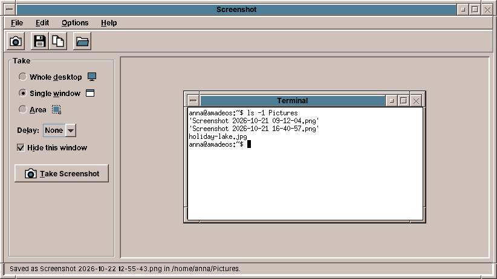

# amade-screenshot

**amade-screenshot** is the screenshot tool of the [amadeOS](https://github.com/datazuul/amadeos) desktop: take the whole desktop, a single window or an area drawn with the mouse, after a delay if you like, and save the picture or copy it to the clipboard. Built like the other amadeOS applications.




## Features

- **What to take**: the whole desktop (all screens), a single window, or an area.
  - For a window or an area the desktop is taken first and shown frozen and dimmed over the whole screen. Moving the mouse lights up the window under it, a click picks it, with its title bar and border. For an area, drag a frame; its size is shown while dragging. Esc or the right mouse button cancels.
  - Because the picture is frozen first, open menus and tooltips stay in it.
- **Delay**: none, 3, 5 or 10 seconds, e.g. to open a menu first. *Hide this window* takes the program's own window out of the picture.
- **Save** (Ctrl+S) puts a PNG in your Pictures folder (`XDG_PICTURES_DIR`, e.g. `~/Bilder`, else `~/Pictures`) named after the date and time, `Screenshot 2026-10-22 14-05-33.png`; a second one in the same second gets `(2)`. **Save As** (Ctrl+Shift+S) asks for name and type (PNG or JPEG). Files are written to a temporary file first and then moved into place. **Open Folder** shows the folder of the last saved screenshot.
- **Copy** (Ctrl+C) puts the picture on the clipboard. On X11 the clipboard only names the program that has the data, so a copied screenshot stays available while amade-screenshot runs. Closing the window does not lose it: the program hands the picture to the desktop's clipboard manager (amadeOS's, or any that follows the freedesktop.org `CLIPBOARD_MANAGER` convention) and ends. Without a clipboard manager it stays in the background until another program puts something on the clipboard, the way `xclip` does.
- **Command line**, e.g. for a key binding:

  ```
  amade-screenshot                                  the window
  amade-screenshot --desktop                        save the desktop in the Pictures folder
  amade-screenshot --window --copy                  pick a window, copy it to the clipboard
  amade-screenshot --area --delay 3 --file a.png    wait 3 s, draw an area, save it as a.png
  amade-screenshot --help
  ```

  The path of a saved file is printed; the exit status is 1 if the screenshot was cancelled or failed.
- Five languages (English, Deutsch, Français, Español, Italiano), following the amadeOS desktop language; *Options → Language* overrides it.
- Theme colours, Motif look and 3D toolbar buttons from [amade-commons](https://github.com/datazuul/amade-commons). The toolbar icons are drawn in Java2D.

## Architecture

Java 25, Swing and Guice; start-up, theme and language come from `AmadeApplication` in amade-commons.

| Package | Contents |
|---|---|
| `bootstrap` | `AmadeScreenshotApplication` (window or command line), `ScreenshotModule`, `QuickShot` (one screenshot without the window) |
| `domain` | `CaptureMode`, `Options`, `CommandLine`, `FileNames`, `ImageFormat`, `Selection` (the geometry of picking) |
| `repository` | `ScreenshotPreferences` (`~/.config/amadeos/screenshot/screenshot.properties`), `PicturesFolder`, `ImageFiles` |
| `service` | `Screen` / `RobotScreen` (pixels via `java.awt.Robot`), `WindowList` / `X11WindowList` (window frames via JNA and libX11 `XQueryTree`), `CaptureService`, `Capture`, `KeepAlive` and `ClipboardHandoff` / `X11ClipboardHandoff` (the copy goes to the clipboard manager) |
| `ui` | `main`: window, presenter, actions, menus; `select`: the full-screen overlay for picking a window or an area; `icons` |

Taking a screenshot: the presenter hides the window, waits the delay plus a moment for the desktop to redraw, then `CaptureService` reads the whole desktop and, for window and area, the list of top-level windows (top first). The overlay shows that frozen picture; the chosen rectangle is cut from it. The mouse pointer is not in the picture.

## Build and run

```sh
./gradlew run                              # start
./gradlew run --args="--area --copy"       # one screenshot from the command line
./gradlew test                             # Swing tests need a display: xvfb-run ./gradlew test
./gradlew deb                              # build/distributions/amade-screenshot_<version>_all.deb
./gradlew installToAmadeOs                 # the .deb into ../amadeos/config/packages.chroot/ for the ISO build
```

If `../amade-commons` is checked out next to this repository, Gradle builds against that checkout instead of the JitPack version.

amade-screenshot is for X11 (the window list comes from libX11), so there is no Windows installer.

## Planned

- Print, Alt+Print and Shift+Print in the amadeOS window manager, running `amade-screenshot --desktop`, `--window` and `--area`
- The mouse pointer in the picture (XFixes), a window without its frame

## License

[EUPL-1.2](LICENSE)
